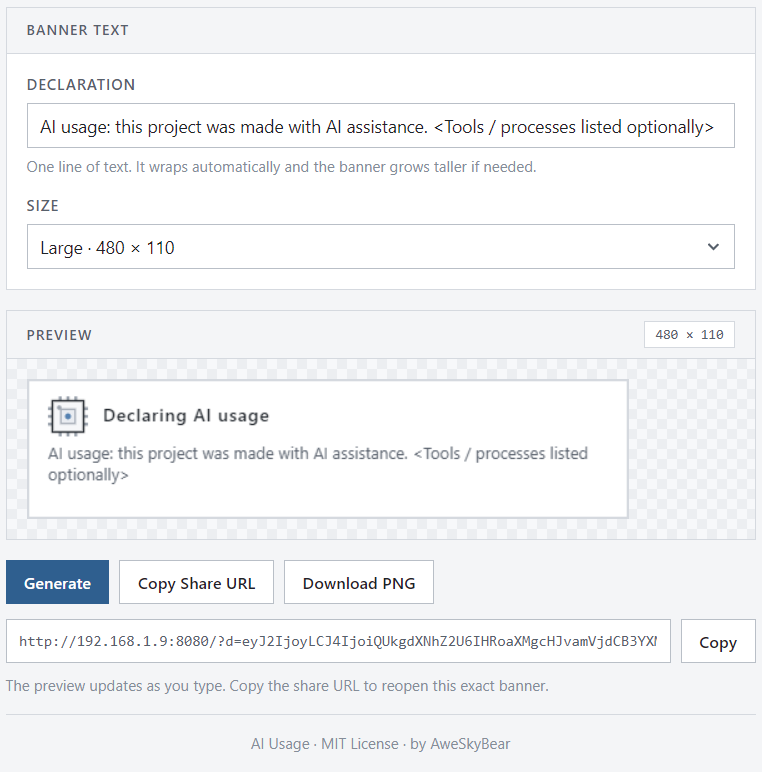
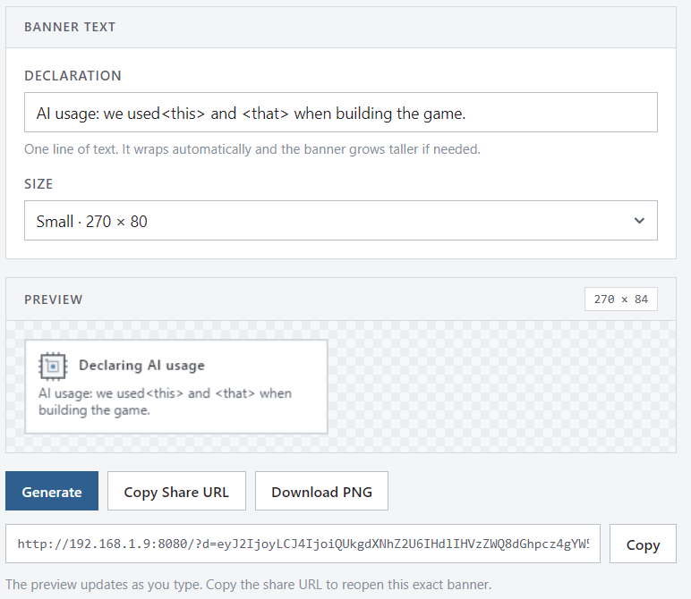
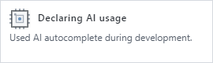
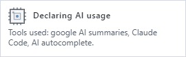
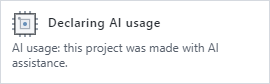
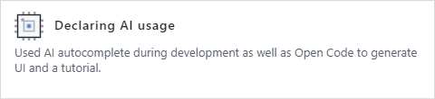
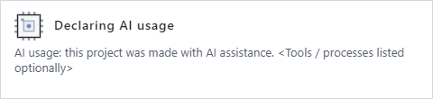

# AI Usage — Disclosure Banner Generator

A tiny, zero-build **AI-disclosure banner generator** for game jams (made with
[Ludum Dare](https://ldjam.com/) in mind).

It produces a small, sober banner headed **"Declaring AI usage"** so you can
honestly state how AI helped you make your jam game. Type one line, export a
PNG, and share a self-contained URL.

The tone is deliberately restrained: the banner is meant to sit on a public
game page without looking like a toy.

## Run it

No build step, no dependencies, no server required:

```
open index.html
```

Everything runs client-side and fully offline — the banner uses system fonts
and a procedurally drawn micro-chip mark, so nothing is fetched from the
network.

## Showcase

The admin page:





Generated banners:

Small size (270 × 80):



Small size with longer text — the banner grows past 80px when the line wraps:





Large size (480 × 110):





## What it generates

A compact banner containing:

1. A small, flat **micro-chip mark** — square body, three pins per side, a
   silicon die with a pin-1 notch, and one status LED that is the only accent
   colour on the banner. The LED breathes very slowly in the live preview;
   PNG exports always capture a still pose, and the animation is skipped for
   anyone with reduced-motion enabled.
2. The fixed title **"Declaring AI usage"** on the same line as the chip.
3. **Your single line of text** on the next line, wrapping automatically. The
   banner **grows taller** when the text needs more lines.

There are no other controls on purpose: one textbox, one size picker.

## Design rules

The whole tool — page and banner alike — follows a strict, non-playful style:

| Rule | Detail |
| --- | --- |
| No rounded corners | Every rectangle, field, button and the banner itself is square. |
| No gradients | Flat fills only, on the page and on the canvas. |
| Near-monochrome | Neutral greys and dark ink; a single restrained blue accent (button, focus ring, chip LED). |
| Small type | Banner text is 12px (small size) / 13px (large size); UI labels are 11–14px. |
| No decoration | No emoji, no animations beyond the chip LED, no background art. |

## Admin controls

| Control | Notes |
| --- | --- |
| Declaration | One line of text; wraps automatically and grows the banner height if needed. |
| Size | Small (270 × 80, **default**) / Large (480 × 110). |

Buttons: **Generate**, **Copy Share URL**, **Download PNG**.

### Download filename

Exports are named from the content and the moment of download:

```
ai-usage-<text-slug>-<YYYY-MM-DD-HHMMSS>.png
```

## Sharing

**Copy Share URL** encodes the configuration as URL-safe base64:

```
index.html?d=<base64url-state>&h=<hash>
```

Opening that link restores the exact same banner. Links produced by the older
version of this tool still open — the old text is carried over and the size
falls back to the default.

### Read-only shared view

When a link is opened (i.e. the URL contains a `d` parameter), the page enters a
**read-only mode**: the editor is hidden and every form input is disabled, so
the link shows only the finished banner. Below it sit three buttons:

| Button | What it does |
| --- | --- |
| **Download PNG** | Saves the banner (same naming scheme as above). |
| **Fork Banner** | Forks the shared banner back into the full editor so you can tweak and re-share it. The URL gains an `&e=1` flag, so reloads stay in edit mode. |
| **Fork on GitHub** | Opens the project repository. |

To keep editing directly, open `index.html` with no parameters.

## Repository

```html
<a class="btn shared-only" id="repoBtn"
   href="https://github.com/AweSkyBear/LD-Jam-Clankers-Helped-Me-Banner-Generator">Fork on GitHub</a>
```

Issues and forks are welcome — the whole thing is one folder of plain
HTML/CSS/JS with no build step, so it is easy to hack on.

## Project layout

```
index.html            admin page
LICENSE               MIT license
assets/
  styles.css          flat, rigid admin styling (square corners, no gradients)
  chip.svg            brand / favicon micro-chip mark
  banner-admin*.png   screenshots of the admin page (showcase)
  sample*.png         generated banner samples (showcase)
  admin.png           generated banner sample, large size (showcase)
src/
  state.js            sizes + default/normalized state
  url.js              base64 + hashing, compact payload, share URL build/read
  render.js           the canvas renderer (chip mark + text, grows on overflow)
  app.js              admin UI wiring (form <-> state <-> render)
```

Classic `<script>` tags are used deliberately so the page works straight from
`file://` without a dev server.

## License

MIT © 2026 **AweSkyBear**. See [LICENSE](LICENSE).
